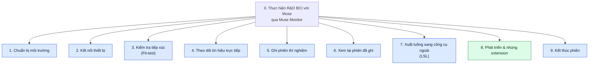
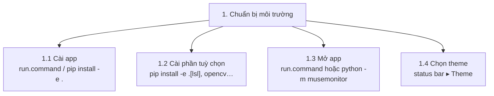
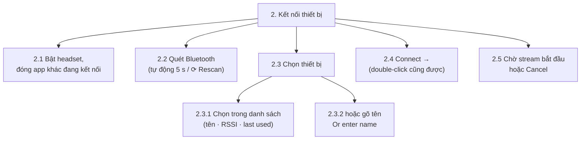
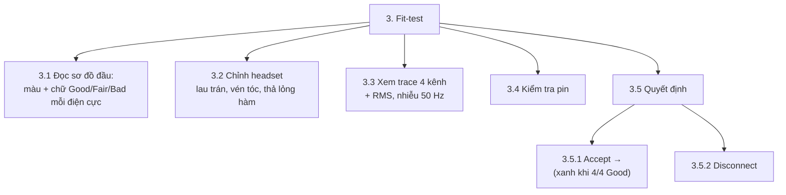
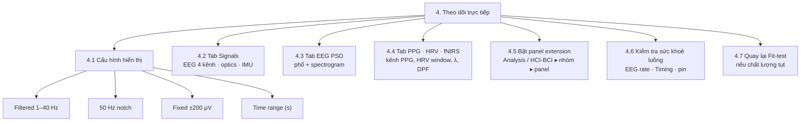
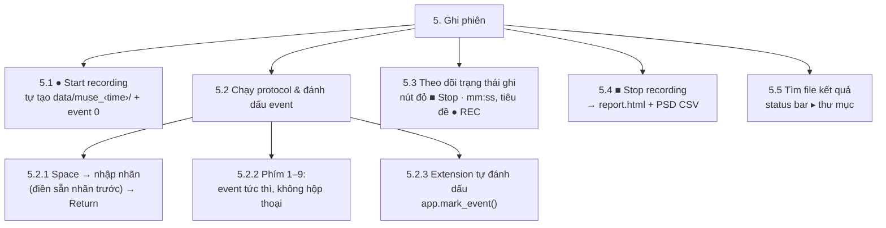
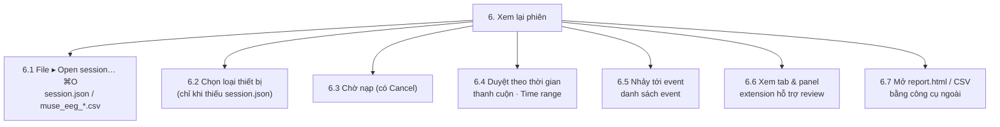
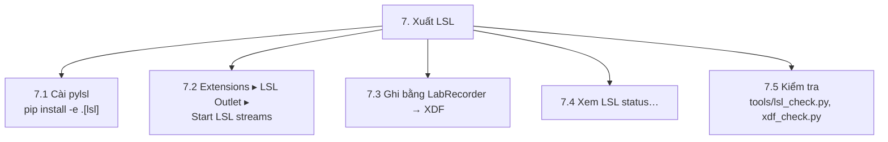
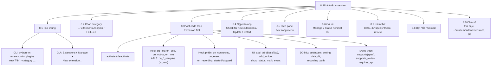
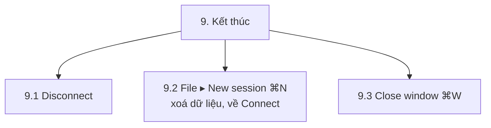

# Hierarchical Task Analysis — Muse Monitor

Persona: nhà nghiên cứu BCI (xem [README.md](README.md)). Ký hiệu HTA chuẩn: mỗi nhiệm vụ được chia thành
nhiệm vụ con, kèm **Plan** nói thứ tự / điều kiện thực hiện. Tên nút, menu, phím giữ nguyên tiếng Anh như trong app.

Cột **UX** đánh dấu điểm đau từ bản đánh giá heuristic (V1–V13); ✅ = đã sửa trên nhánh hiện tại.

## 0. Tổng quan

**Plan 0:** Lần đầu: 1. Mỗi phiên vận hành: 2 → 3 → 4 → 5 (lặp 4–5 theo protocol) → 9; quay về 3 bất cứ lúc
nào chất lượng tụt. 6 và 7 tuỳ chọn, 6 có thể chạy song song khi cửa sổ live vẫn mở. 8 là vòng lặp riêng của
vai phát triển, xen kẽ với 4–6 để thử extension trên dữ liệu thật hoặc dữ liệu đã ghi.

---

## 1. Chuẩn bị môi trường

**Plan 1:** 1.1 → (1.2 nếu cần LSL / camera) → 1.3; 1.4 tuỳ ý, được nhớ giữa các lần mở.

| UX | Ghi chú |
|---|---|
| V9 | Chọn theme nằm ở status bar thay vì menu — khó tìm |

## 2. Kết nối thiết bị

**Plan 2:** 2.1 → 2.2 (app tự quét khi mở). Nếu "No device found" → 2.1 rồi 2.2 lại. 2.3.1 hoặc 2.3.2 → 2.4 → 2.5.
Stream bắt đầu → tự chuyển sang 3. Lỗi kết nối → status báo lỗi, quay lại 2.1. Thiết bị thuộc profile khác →
app mở cửa sổ mới cho profile đó.

| UX | Ghi chú |
|---|---|
| V5 | Đã tìm thấy 1 thiết bị nhưng Connect vẫn xám cho đến khi bấm vào dòng; danh sách chiếm phần lớn màn hình và có nền tối trong theme Light; không có spinner khi quét |

## 3. Kiểm tra tiếp xúc (Fit-test)

**Plan 3:** 3.4 một lần. Lặp {3.1 → 3.2 → 3.3} đến khi "4/4 channels Good ✓ Ready to record" hoặc người dùng
chấp nhận chất lượng hiện có → 3.5.1 (sang 4). 3.5.2 nếu bỏ phiên → 2. Từ trang Recording có thể quay lại bằng ◀ Fit-test.

| UX | Ghi chú |
|---|---|
| V6 | Accept khi còn kênh Bad không có cảnh báo, chất lượng lúc Accept không được lưu |
| V7 | Chữ "Good" đè lên đường viền đầu; chữ trắng trên màu Fair tương phản thấp |
| V4 | Chỉ số `8 µV · 50Hz 2` thiếu nhãn/đơn vị |

## 4. Theo dõi tín hiệu trực tiếp

**Plan 4:** 4.1 khi cần (cài đặt áp dụng ngay cho mọi tab). Chuyển tự do giữa 4.2 / 4.3 / 4.4 / panel của 4.5.
4.6 liếc định kỳ; Timing ≠ OK hoặc kênh Bad → 4.7 (= 3).

| UX | Ghi chú |
|---|---|
| V4 | Hai hàng telemetry dày đặc (`Received`, `Latest µV` nhảy liên tục); `ts↓`, `seq?` khó hiểu |
| V7 | Nhãn trục "Optical (mean-remov…" bị cắt; chú thích x/y/z đè lên đường Gyro |
| V11 | Trục thời gian chỉ là tương đối, không có giờ thật |

## 5. Ghi phiên thí nghiệm

**Plan 5:** 5.1 → lặp {5.2 theo protocol, 5.3 liếc định kỳ} → 5.4 → 5.5. Trong 5.2: 5.2.1 cho event cần mô tả,
5.2.2 cho mã kích thích lặp lại; 5.2.3 chạy nền. Ngắt kết nối / New session / đóng cửa sổ khi đang ghi → hộp
xác nhận, mặc định "Keep recording". Mất kết nối giữa chừng → dữ liệu và report vẫn được ghi.

| UX | Ghi chú |
|---|---|
| ✅ V1 | Trạng thái ghi: nút đỏ có đồng hồ, tiêu đề cửa sổ "● REC 3:07 — Muse Monitor" (hiện cả trên Dock, ở mọi trang) |
| ✅ V2 | Disconnect / ⌘N / ⌘W / nút đóng cửa sổ hỏi trước khi dừng ghi; Disconnect dời ra mép phải, xa nút ghi |
| ✅ V3 | Phím 1–9 đánh dấu tức thì; Space điền sẵn và bôi đen nhãn trước → Return lặp lại nhãn, gõ để thay |
| V13 | Sau khi dừng không có nút "Mở thư mục / report" |

## 6. Xem lại phiên đã ghi

**Plan 6:** 6.1 → (6.2 nếu app hỏi) → 6.3 → lặp {6.4 | 6.5, 6.6} → 6.7 tuỳ ý. Mỗi phiên mở trong cửa sổ Review
riêng; cửa sổ live vẫn chạy.

## 7. Xuất luồng sang công cụ ngoài (LSL)

**Plan 7:** 7.1 một lần → (sau 2) 7.2 → 7.3; 7.4 khi nghi ngờ; 7.5 sau khi ghi XDF.

## 8. Phát triển & nhúng extension (vai phát triển)

**Plan 8:** 8.1 (CLI hoặc GUI) → 8.2 → lặp {8.3 → 8.4 → 8.5 → (lỗi? 8.6)} đến khi chạy đúng → 8.7 → 8.9.
Extension mới mặc định ẩn: sau 8.4 phải 8.5. Thêm extension mới: 8.4 nạp ngay; sửa code extension đã nạp: phải
khởi động lại app. Extension lỗi bị tắt riêng, app tiếp tục chạy → 8.6. 8.8 khi cần so sánh có/không extension.

| UX | Ghi chú |
|---|---|
| — | Sửa code extension đang chạy phải khởi động lại app → vòng lặp 8.3–8.5 chậm |
| V10 | `show_status` của extension lẫn với thông báo hệ thống trên status bar |

## 9. Kết thúc phiên

**Plan 9:** 9.1 hoặc 9.2 để bắt đầu người tham gia tiếp theo; 9.3 để thoát. Nếu đang ghi, cả ba hỏi xác nhận
trước (✅ V2), dừng ghi và vẫn ghi report.

---

## Nhận xét từ HTA

1. **Nhiệm vụ 5 là chỗ cần chú ý nhất:** chú ý của người dùng bị chia đôi (người tham gia ↔ màn hình). V1–V3 nằm
   ở đây và đã được sửa.
2. **Vòng lặp 8.3 → 8.5 là nút thắt của vai phát triển.** Hot-reload extension đang nạp sẽ rút ngắn vòng lặp này,
   nhưng đụng vòng đời của extension nên cần đề xuất trong `debate/` trước.
3. **Nhiệm vụ 3 ↔ 4 lặp lại nhiều** nhưng chuyển qua lại chỉ cần một nút (◀ Fit-test / Accept), đã hợp lý.
4. **Nhiệm vụ 6 tách thành cửa sổ riêng** nên xem lại không chặn phiên live, khớp nhu cầu so sánh ngay trong lab.
