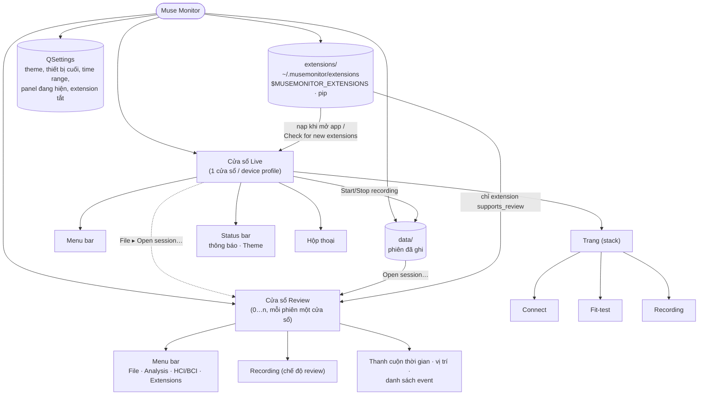
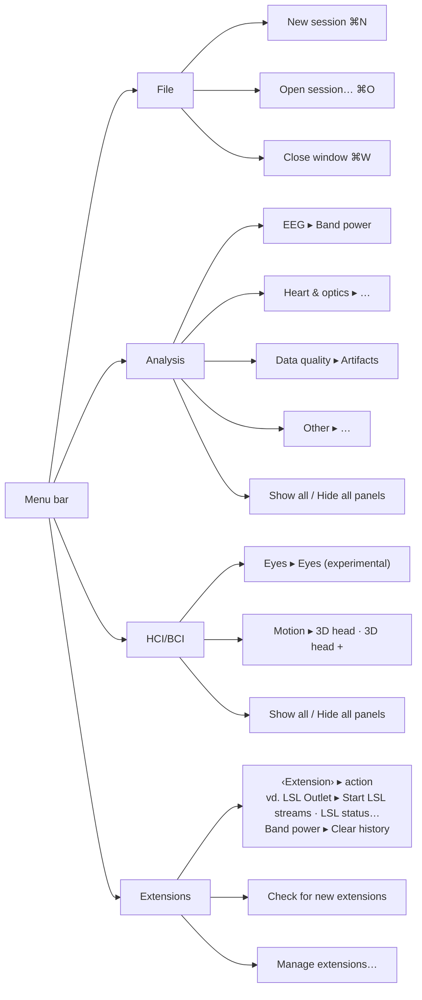
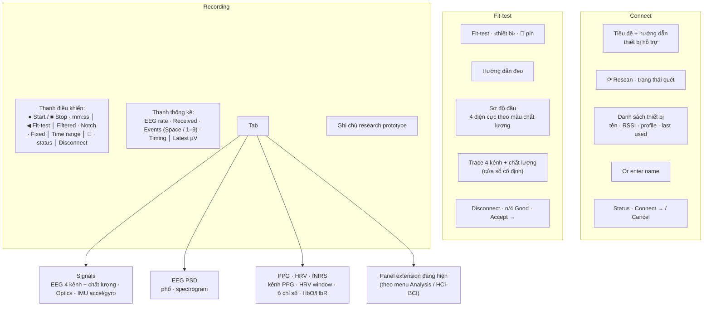
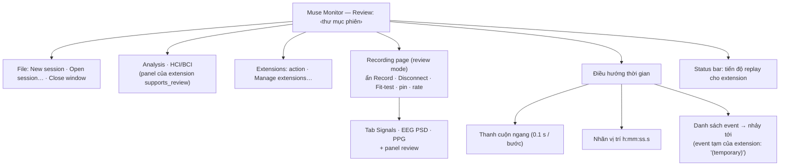
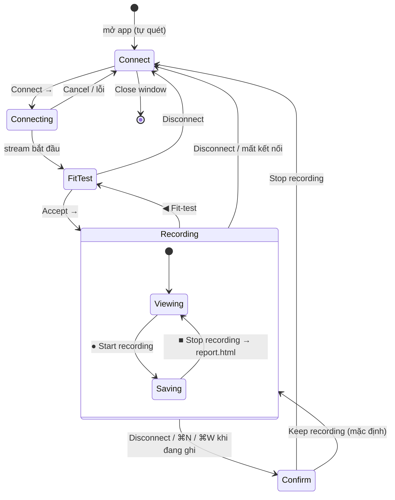
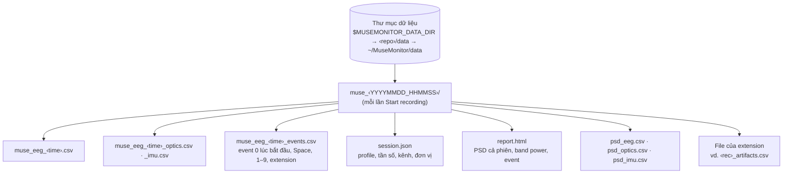
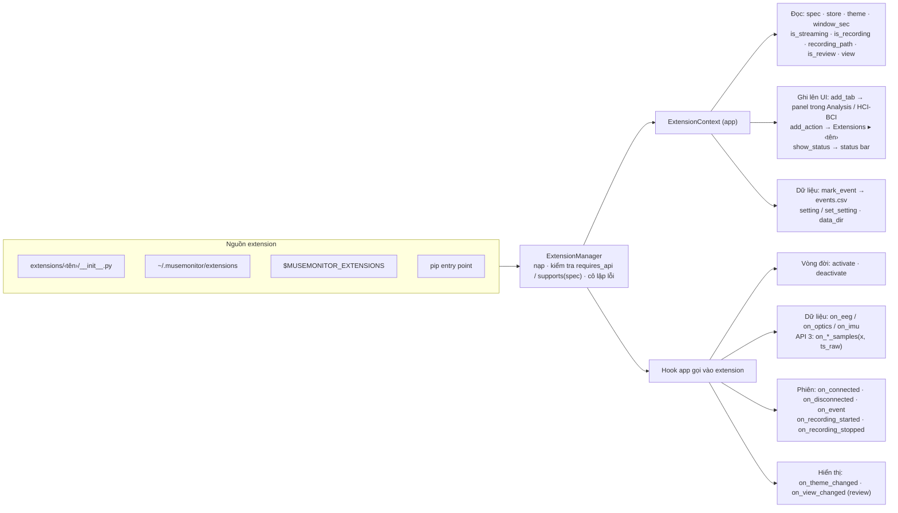

# Information Architecture — Muse Monitor

Cấu trúc thông tin của app gồm 4 lớp: (1) cửa sổ và màn hình, (2) menu và hộp thoại, (3) điều hướng giữa các
trạng thái, (4) dữ liệu trên đĩa và extension. Tên giữ nguyên như trong app.

## 1. Bản đồ tổng thể

## 2. Cửa sổ Live

### 2.1 Menu bar

- **Analysis** và **HCI/BCI** chứa *panel* (tab của extension), gom theo `category` khai báo trong extension
  (`plugins/api.py: CATEGORIES`). Panel mặc định ẩn, hiện khi được tick; trạng thái tick được nhớ riêng cho cửa sổ live và review.
- **Extensions** chứa *action* (`app.add_action`), mỗi extension một submenu.
- Mục trong menu là ví dụ từ extension đi kèm; danh sách thay đổi theo extension được cài.

### 2.2 Trang và nội dung

### 2.3 Hộp thoại

| Hộp thoại | Mở từ | Nội dung |
|---|---|---|
| **Mark event** | Space trên trang Recording | Thời điểm nhấn Space (ms), ô nhãn điền sẵn nhãn trước; Return = lưu, Esc = huỷ, gợi ý phím 1–9 |
| **Recording in progress** | Disconnect / New session / Close khi đang ghi | Thời gian đã ghi, hậu quả; *Stop recording* / **Keep recording** (mặc định) |
| **Extensions** | Extensions ▸ Manage extensions… | Bảng Enabled · Extension · Version · Status · Menu; chi tiết + lỗi; Update · Load/Unload · New extension… · Open extensions folder |
| **New extension** | Extensions dialog ▸ New extension… | Tên, category → vị trí menu dự kiến |
| **Open recording** | File ▸ Open session… | Chọn file, mở sẵn thư mục `data/` |
| **Which device recorded this?** | Mở file không có `session.json` | Chọn profile hoặc "Other device — estimate rates" |
| **Loading…** | Sau khi chọn file | Tiến độ nạp, Cancel |
| Hộp thoại riêng của extension | Action của extension | vd. LSL status… |

## 3. Cửa sổ Review

Trong Review, extension chỉ có tác dụng tạm: `mark_event` vẽ marker tạm, `set_setting` chỉ giữ trong bộ nhớ,
không ghi file nào.

## 4. Điều hướng (trạng thái cửa sổ Live)

File ▸ New session (từ bất kỳ trạng thái nào) → dừng ghi nếu có, ngắt kết nối, xoá dữ liệu và event → Connect.

## 5. Dữ liệu trên đĩa

## 6. Kiến trúc extension (góc nhìn người phát triển)

## 7. Nhận xét IA

1. **Tổ chức theo tác vụ là hợp lý:** 3 trang nối tiếp nhau khớp với nhiệm vụ 2 → 3 → 4/5 trong [HTA.md](HTA.md).
2. **Menu chia theo bản chất nội dung:** *panel* (xem) nằm trong Analysis / HCI-BCI, *action* (làm) nằm trong
   Extensions. Người phát triển chỉ cần khai báo `category`. Nhược điểm: một extension có cả panel lẫn action thì
   bị chia ra hai nơi.
3. **Thiếu một nơi cho cài đặt:** Theme ở status bar, Time range và bộ lọc ở thanh điều khiển, extension tắt/bật
   ở hộp thoại. Không có menu View/Preferences (V9).
4. **Thông tin chẩn đoán chưa có chỗ riêng:** telemetry chiếm vị trí chính trên trang Recording (V4). Một panel
   "Diagnostics" sẽ tách được lớp thông tin này.
5. **Liên kết dữ liệu → app đi một chiều:** app ghi vào `data/` nhưng chỉ có status bar trỏ về đó; không có
   "Recent sessions" hay nút mở thư mục (V13).
